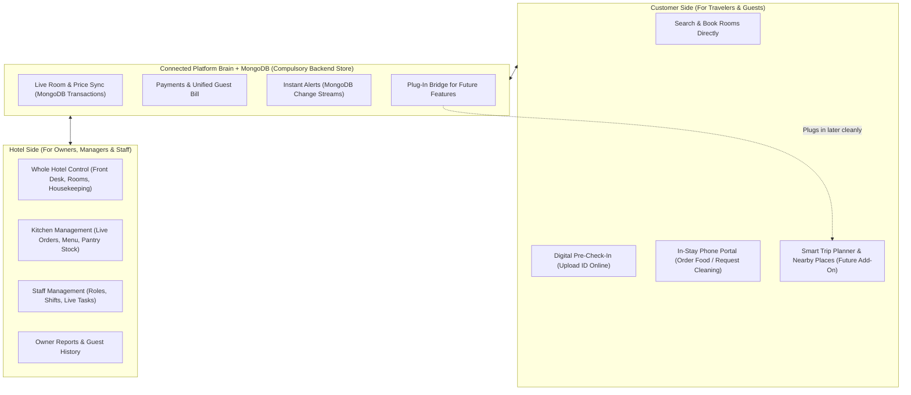
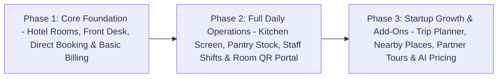

# Unified Hospitality & Guest Experience Platform — Project Blueprint

> **Current Project Stage:** Vision, Idea Framing & System Exploration  
> **Compulsory Database & Backend Core:** MongoDB (Collections, ACID Transactions, Live Change Streams & Location Search)  
> **Implementation Status:** Not started yet — we are currently structuring the entire vision clearly before writing any code.

---

## 1. The Idea in One Minute

Most hotels run on messy, disconnected tools: one system for room bookings, another for the restaurant kitchen, spreadsheets or WhatsApp for staff duties, and third-party apps (like Booking.com or MakeMyTrip) that take a big commission from every room booked.

Meanwhile, guests have to deal with slow check-ins, paper room-service menus, phone calls for basic requests, and zero help planning what to explore around the hotel.

**Our Startup Idea solves both sides in one connected system:**

1. **The Hotel Side (Operations System):** Gives hotel owners and staff one unified platform to manage the **entire hotel**, **kitchen & food**, **staff shifts & tasks**, **billing**, and **business reports**.
2. **The Customer Side (Booking & Stay Experience):** Gives travelers a smooth platform to **search and book hotels**, **check in digitally**, **order room service or cleaning from their phone**, and later unlock **smart add-ons like a personal Trip Planner and nearby best places to visit**.

When a guest does something on the Customer Side, the Hotel Side reacts automatically in real time — and vice versa.

---

## 2. How Everything Connects (Big Picture Diagram)

---

## 3. Why This Matters (Problems Solved)

| Who | Current Problem | How Our Platform Solves It |
| :--- | :--- | :--- |
| **Hotel Owner** | Pays 15%–25% commission to third-party booking sites and pays for 4 separate software tools | One all-in-one platform + direct bookings directly from customers with much lower cost |
| **Front Desk Staff** | Manual paperwork, double-booking errors, chasing housekeeping on phone calls | Live room status screen, automatic cleaning alerts on checkout, fast digital check-in |
| **Kitchen Team** | Lost paper food orders, guests waiting too long, running out of ingredients unexpectedly | Live Kitchen Screen (KDS), automatic ingredient stock deduction, instant room-bill sync |
| **Ground Staff** | Unclear daily duties, messy shift schedules on paper/WhatsApp | Clean mobile task list with shift schedules and clear completion tracking |
| **Hotel Guest** | Waiting at reception, calling reception for towels/food, figuring out local sightseeing alone | Fast check-in, order anything from room QR code, live food tracking, and built-in Trip Planner |

---

## 4. Simple Startup Business Model

How this product becomes a scalable startup business:

1. **Monthly Software Subscription (Core SaaS Income):** Hotels pay a monthly plan based on their size (number of rooms) and features used (Basic Hotel, Kitchen Suite, Staff Suite, Multi-Branch Enterprise).
2. **Small Direct Booking Fee:** When customers book directly through our system, we charge a tiny platform fee compared to the heavy 15%–25% commissions charged by traditional booking portals.
3. **Future Travel & Experience Commissions:** When our Trip Planner recommends local tours, cab rides, or adventure activities and a guest books them, our startup and the hotel can earn a partner commission.

---

## 5. Phased Growth Plan (From Core to Full Startup)

We will not try to build everything on Day 1. We build in **3 clean stages** so every stage works smoothly on its own:

---

## 6. Explore Every Section in Detail

Read each document below for a complete, plain-language explanation with step-by-step flowcharts:

| Chapter | What It Covers | Link |
| :--- | :--- | :--- |
| **01 — Hotel Side** | Whole hotel management, Kitchen & pantry, Staff management, Owner reports | [docs/01-hotel-side-explained.md](docs/01-hotel-side-explained.md) |
| **02 — Customer Side** | Search & booking, pre-check-in, room QR experience, checkout & reviews | [docs/02-customer-side-explained.md](docs/02-customer-side-explained.md) |
| **03 — Future Add-Ons** | Trip Planner, nearby visiting places, partner marketplace & future plug-ins | [docs/03-future-addons-and-trip-planner.md](docs/03-future-addons-and-trip-planner.md) |
| **04 — End-to-End Flows & Roadmap** | Complete guest-to-hotel story diagram, safety rules, phased roadmap & next questions | [docs/04-end-to-end-flows-and-roadmap.md](docs/04-end-to-end-flows-and-roadmap.md) |
| **05 — MongoDB & Backend Structure** | Compulsory MongoDB setup, collections map, transactions, live Change Streams & GPS search | [docs/05-mongodb-architecture-explained.md](docs/05-mongodb-architecture-explained.md) |
