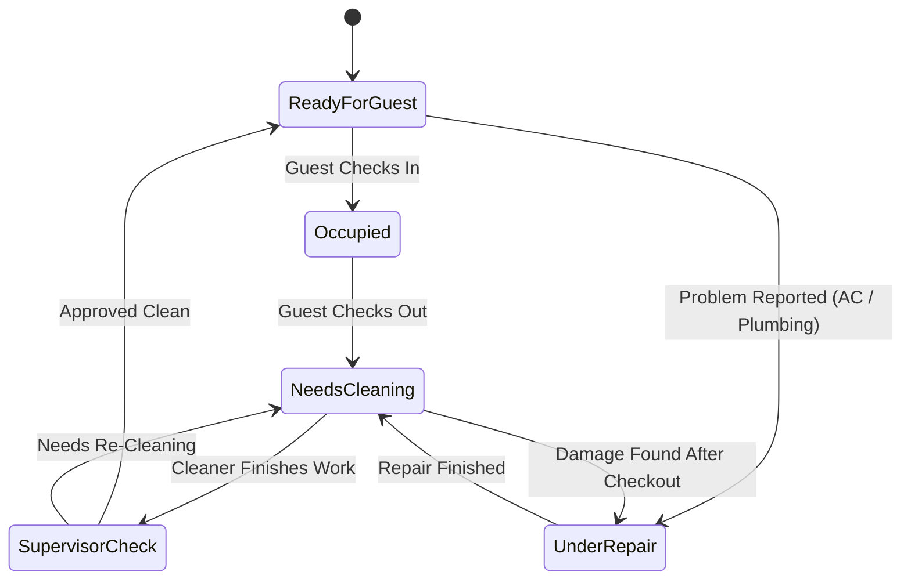
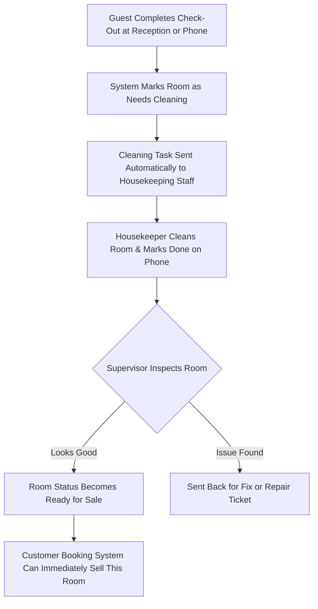
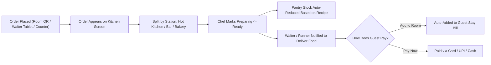
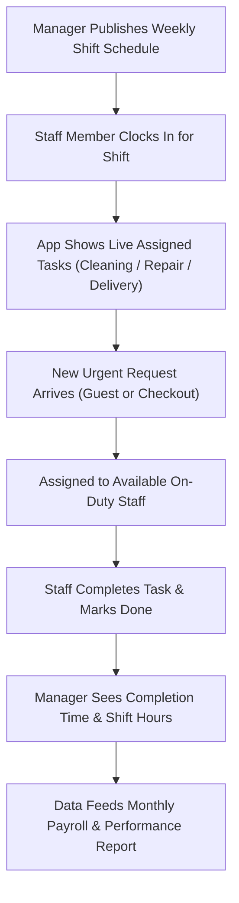

# 01 — The Hotel Side Explained (B2B Operations Suite)

The **Hotel Side** is the daily workspace used by everyone running the property: the **Owner**, **General Manager**, **Receptionists**, **Chefs**, **Waiters**, **Housekeepers**, and **Maintenance Staff**.

Instead of using separate apps for rooms, food, and staff, everything lives inside **four connected modules**.

---

## Module 1: Whole Hotel Management (Front Desk, Rooms & Billing)

Think of this as the **control tower** of the hotel. It knows which rooms exist, which ones are clean or dirty, who is staying in which room, and how much money is owed.

### Key Features in Simple Words
1. **Room & Floor Setup:** Organize the hotel by floors and room types (Standard, Deluxe, Suite), along with photos, bed types, and prices.
2. **Live Room Status Board:** Reception can see every room in real time using clear color-coded states.
3. **Reservations & Front Desk:** Manage online bookings, phone bookings, walk-in guests, stay extensions, early check-in, late check-out, and room upgrades.
4. **Housekeeping Connection:** The moment a guest checks out, the room automatically switches to **"Needs Cleaning"** and alerts the cleaning team. Once cleaned and checked by a supervisor, it becomes **"Ready for Next Guest"**.
5. **Maintenance & Repairs:** If an AC or pipe breaks in Room 204, staff log a repair ticket and the system **automatically blocks Room 204 from being booked** until fixed.
6. **One Combined Guest Bill (Folio):** Instead of separate paper bills for room rent, dinner, laundry, and airport cab, everything goes onto **one clean bill** for the guest, including taxes.
7. **Multi-Hotel Support:** If one owner runs 3 hotels in different cities, they can switch between them or view all 3 from one main dashboard.

### Diagram: Life Cycle of a Hotel Room

### Flowchart: Check-Out to Next Guest Ready

---

## Module 2: Kitchen & Food Management (POS, Kitchen Screen & Pantry)

Hotels lose huge amounts of money when food orders get misplaced, dishes take too long, or kitchen ingredients expire or go missing. This module connects **Orders -> Chefs -> Pantry Stock -> Guest Bill**.

### Key Features in Simple Words
1. **Multiple Ways Orders Come In:**
   - A guest orders food from their phone inside the room (Room Service).
   - A waiter takes an order at a restaurant table using a tablet.
   - A customer orders directly at the hotel cafe or bar counter.
2. **Live Kitchen Display Screen (KDS):**
   - Instead of shouting orders or losing paper slips, orders appear neatly on a kitchen screen.
   - Items automatically route to the right section: **Hot Kitchen** gets the curry, **Bakery** gets the dessert, and **Bar** gets the drinks.
   - Shows a timer for how long each order has been waiting and highlights **allergy warnings** (like "No Peanuts").
3. **Smart Menu & Recipe Connection:**
   - Every dish has a simple ingredient recipe saved behind it (for example: *1 Butter Chicken = 250g chicken + 50g butter + cream + spices*).
   - Whenever a dish is ordered, the system **automatically subtracts those ingredients from the pantry stock**.
   - If the kitchen runs out of paneer, dishes using paneer can automatically show as **"Currently Unavailable"** on the guest menu so guests do not order something the kitchen cannot make.
4. **Pantry, Vendors & Food Waste Control:**
   - Tracks dry storage, fridge/freezer items, and drinks.
   - Alerts the manager when milk, rice, or coffee is running low so they can order from suppliers on time.
   - Logs spoiled or wasted food daily so owners can see where money is leaking.
5. **Instant Room Bill Sync:**
   - When a hotel guest eats at the restaurant or orders room service, they can simply say **"Add it to my room bill"** and it instantly appears on their hotel stay bill.

### Flowchart: How a Food Order Travels from Guest to Kitchen to Bill

---

## Module 3: Staff & Workforce Management

A hotel runs smoothly only when every team member knows their shift, their exact permissions, and what task needs to happen next.

### Key Features in Simple Words
1. **Role-Based Access (Everyone Sees Only What They Need):**
   - **Owner / Manager:** Sees money, profits, discounts, reports, and all staff.
   - **Front Desk:** Sees rooms, check-ins, check-outs, and guest bills (cannot delete financial records).
   - **Chef / Kitchen Staff:** Sees food orders, recipes, and pantry stock (does not see room prices).
   - **Housekeeping / Maintenance:** Sees only their cleaning or repair checklist.
2. **Shift Planning & Attendance:**
   - Create weekly/monthly duty schedules for morning, afternoon, and night shifts.
   - Staff clock in and out when arriving at work (via PIN, QR code, or biometric machine later).
   - Staff can request leaves or swap shifts with manager approval.
   - **Smart Busy-Day Tip:** When the booking calendar shows the hotel is 95% full next weekend, the system reminds the manager to schedule extra cleaners and kitchen helpers.
3. **Live Task Checklist:**
   - Every duty becomes a clear digital ticket with a time goal (example: *"Deliver 2 towels to Room 302 within 10 mins"* or *"Clean Room 108 before 1:00 PM"*).
   - Managers can instantly see who finished what and which tasks are running late.
4. **Salary & Performance Summary:**
   - Tracks total hours worked, overtime, tips collected, and average speed (like average room cleaning time) for easy monthly payroll calculation.

### Flowchart: Staff Daily Shift & Task Loop

---

## Module 4: Owner Control Panel, Guest History & "Many More"

Beyond daily operations, an industry-level system helps owners grow profits and prevent fraud:

1. **Simple Owner Dashboard:**
   - **How full is the hotel?** (Occupancy % today and next 30 days)
   - **Average room price sold** and **total money made per room**.
   - **Kitchen profitability:** Total food sales vs. ingredient cost vs. daily wastage.
   - **Department speed:** How fast rooms get cleaned and how fast food gets delivered.
2. **Guest Memory (CRM):**
   - Remembers repeat guests: their favorite room type, food allergies, birthday/anniversary dates, or VIP status—making every returning guest feel remembered.
3. **Anti-Fraud & Security Logs:**
   - Every time someone gives a manual discount, cancels a restaurant bill, or refunds money, the system writes an **uneditable log** showing who did it and why. This stops internal theft and errors.
