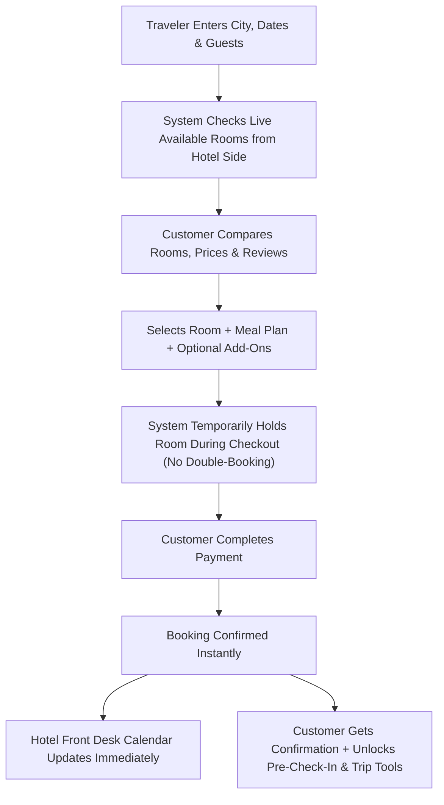
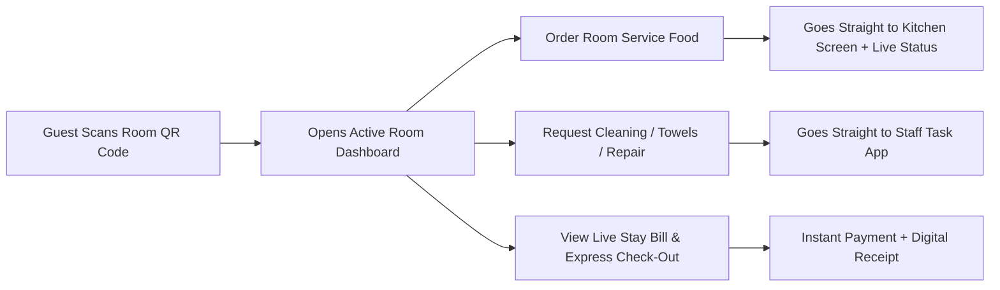

# 02 — The Customer Side Explained (B2C Booking & Stay Experience)

The **Customer Side** is everything the traveler interacts with—from the moment they start looking for a hotel until after they return home.

Our goal is to make the guest feel taken care of without needing to download heavy apps or wait in reception lines.

---

## Stage 1: Discovery & Direct Booking System

This is how travelers find the hotel, compare rooms, and confirm their stay online.

### Key Features in Simple Words
1. **Easy Search & Filters:**
   - Search by city/destination, check-in & check-out dates, number of adults/children, price range, and facilities (pool, parking, Wi-Fi, pet-friendly, breakfast included).
2. **Clear Room Details:**
   - Real-time availability pulled directly from the Hotel Side (so if the last Deluxe Room just sold out, it disappears instantly—no false promises).
   - Honest photos, bed size, room size, view details, meal plans, and clear cancellation rules.
3. **Helpful Add-Ons During Booking:**
   - Before paying, guests can easily add extras: *Breakfast package, Airport pickup cab, Early check-in, Romantic room decoration, or Extra bed*.
4. **Smooth Payments & Instant Confirmation:**
   - Supports cards, UPI/wallets, pay-partial-now or pay-at-hotel options (depending on hotel rules).
   - Immediately sends a clean digital booking confirmation and receipt via email/WhatsApp.

### Flowchart: Customer Search to Confirmed Booking

---

## Stage 2: Before Arrival (Digital Pre-Check-In)

Instead of standing tired at the reception desk for 15 minutes filling out paper forms and handing over ID cards:

1. **Upload ID Ahead of Time:** Guests can securely upload their passport/ID photo from home.
2. **Share Arrival Time & Preferences:** Tell the hotel *"Landing at 11 AM, need extra pillows, vegetarian food preference"*.
3. **60-Second Arrival:** When the guest reaches the hotel, reception already has everything verified—they just hand over the room key and welcome them.

---

## Stage 3: During the Stay (Digital Room Concierge)

Once inside the room, the guest simply scans a **QR code on the room table** (or opens their booking link on their phone browser—**no app download needed**).

### What the Guest Can Do From Their Phone
1. **Order Food to Room (Connected Straight to Kitchen):**
   - Browse live photos & prices (items that are out of stock are already hidden).
   - Add special cooking notes (*"Make it less spicy"*).
   - Track order live: *Order Received -> Chef Cooking -> On the Way to Room 204*.
2. **One-Tap Hotel Services:**
   - Request room cleaning now or set "Do Not Disturb".
   - Ask for fresh towels, water bottles, iron, or luggage help.
   - Report an issue like a flickering light or slow Wi-Fi with one tap—it goes directly to the maintenance staff.
3. **Book Hotel Facilities:**
   - Reserve a restaurant dinner table, spa slot, or gym/pool session.
4. **Live Bill & Express Check-Out:**
   - See every charge (room + food + extras) anytime on their phone—no surprises at the end.
   - Pay remaining balance online and tap **"Check Out"** from the room before heading down.

### Flowchart: In-Stay Guest Phone Experience

---

## Stage 4: After the Stay (Reviews & Loyalty)

1. **Honest Verified Reviews:** Only guests who actually stayed can leave ratings—broken down clearly into *Room Comfort, Cleanliness, Food Quality, and Staff Service*.
2. **Instant Tax Invoices:** Easy download of GST/tax invoices for personal or business reimbursement.
3. **Repeat Guest Rewards:** Guests earn loyalty points or special perks when booking directly through our platform again, reducing the hotel's dependence on high-commission third-party sites.
