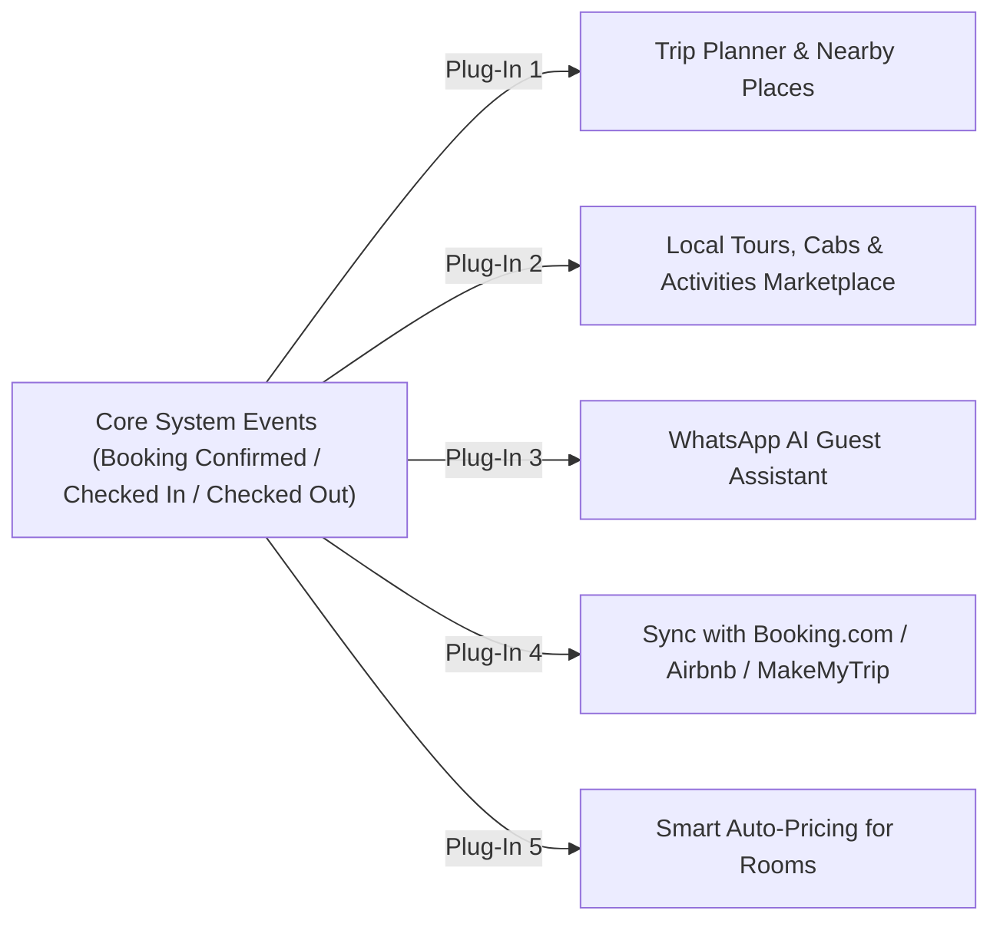
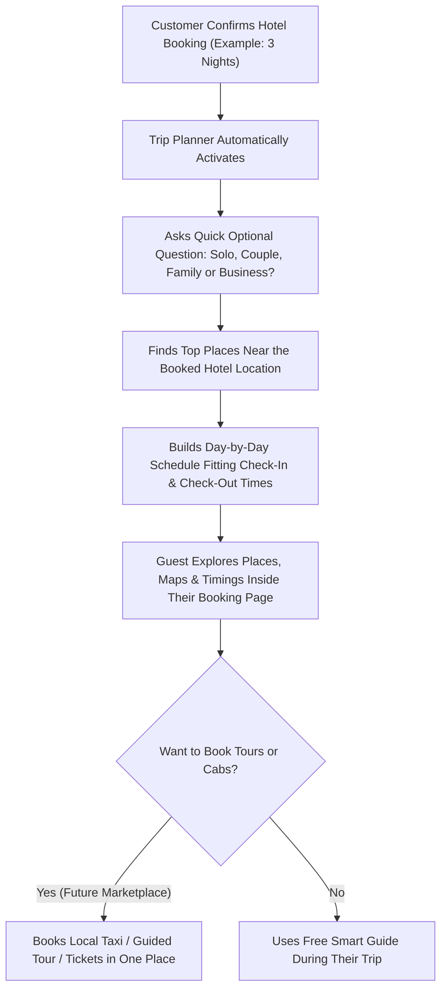

# 03 — Future Add-Ons & The Smart Trip Planner Ecosystem

Right now, we are focusing on understanding the **Core System** (Hotel Management + Kitchen + Staff + Customer Booking).

However, because we plan to turn this into a full **startup**, we should design the system like **building blocks (plug-ins)**. That means we keep the core clean and solid, and whenever we are ready, we can plug in exciting new features without breaking anything we already built.

---

## How Future Features Plug Into the Core (Simple Concept)

Whenever something important happens in the core system (like *"Guest Confirmed a Booking"* or *"Guest Checked In"*), the core sends out a small signal. Future features simply listen to that signal and jump into action automatically.

---

## Signature Future Feature: Smart Trip Planner & Nearby Best Visiting Places

This turns our platform from *"just another hotel booking website"* into a **complete travel companion**.

### How It Works in Simple Words
The moment a customer books a hotel stay (say, 3 nights in Goa or Jaipur), our platform does not stop at showing a confirmation receipt. It immediately unlocks a **Personalized Trip Guide** built around that specific hotel's location and the guest's exact dates:

1. **Smart Day-by-Day Itinerary:**
   - Automatically builds a clean Day 1, Day 2, Day 3 schedule tailored to:
     - When the guest arrives and checks out,
     - Who is traveling (Family with kids, Couple, Solo traveler, Friends, or Business trip),
     - Interests (History, Beaches, Food & Cafes, Nature, Shopping, Nightlife).
2. **Nearby Best Visiting Places (Curated Around the Hotel):**
   - Shows top landmarks, hidden local gems, best nearby cafes/street food, scenic sunset points, and even essentials (ATMs, pharmacies, hospitals).
   - Displays **exact travel distance and time from the hotel** (*"12 mins drive from your hotel — Best visited at 5:00 PM"*).
3. **Practical Smart Tips:**
   - Entry fees, opening/closing hours (so guests don't reach a museum on the day it is closed), local dress tips, and weather alerts.

### Flowchart: What Happens Right After Booking a Hotel

### Why This Is Huge for the Startup Business
- **Customers Love It:** They don't have to jump between 5 blogs, Google Maps, and travel apps after booking a room.
- **Hotels Love It:** Happier guests give better reviews, and the hotel becomes the center of their trip.
- **New Revenue Stream:** When guests book local airport cabs, scooter rentals, city tours, or attraction tickets inside the Trip Planner, our startup earns a partner commission on top of hotel software income!

---

## Other Powerful Future Add-Ons ("Many More")

Once the core hotel + customer system is running strongly, here are other industry-level plug-ins we can add step by step:

| Future Add-On | What It Does in Simple Words | Why It Matters |
| :--- | :--- | :--- |
| **1. Channel Manager (OTA Sync)** | Automatically connects our hotel calendar with Booking.com, Airbnb, Expedia, and MakeMyTrip | Stops double-bookings completely when a hotel lists rooms on multiple sites |
| **2. WhatsApp Guest Bot** | Lets guests book rooms, check in, receive trip plans, and order coffee simply by messaging on WhatsApp | Huge adoption because guests already use WhatsApp all day |
| **3. Event, Wedding & Banquet Manager** | Manages large group bookings, marriage halls, conference rooms, bulk kitchen catering, and extra event staff | Unlocks high-value wedding & corporate resort customers |
| **4. Smart Dynamic Pricing** | Automatically suggests raising room rates during festivals/long weekends or offering discounts on empty weekdays | Helps hotels earn 10%–20% more revenue automatically |
| **5. Smart Door Locks (IoT)** | Sends a digital key to the guest's phone to unlock their hotel room door without plastic keycards | Modern luxury feel + reduces front desk workload |
| **6. Multi-Language & Multi-Currency** | Automatically translates menus/trip plans and supports international currencies | Enables global startup expansion |
