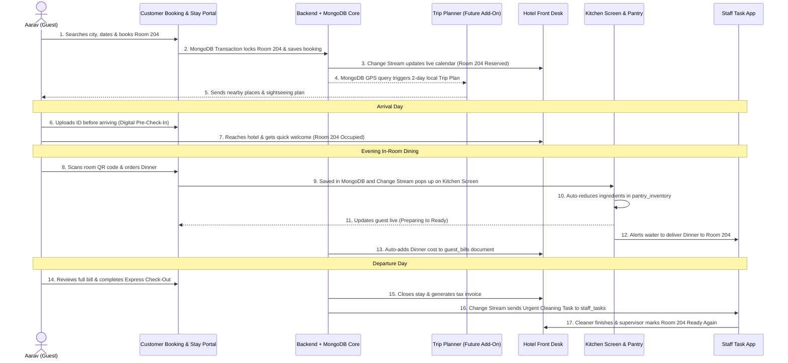

# 04 — End-to-End Flow, Safety Rules & Phased Roadmap

This chapter puts the **entire system together** into one real-life story so you can see how every module talks to the others, followed by our step-by-step build plan and key decisions to explore next.

---

## 1. One Complete Real-Life Journey (Customer + Hotel Together)

Imagine **Aarav** books a 2-night hotel stay. Watch how every piece of our system works together automatically:

---

## 2. What Makes This "Industry-Level" (Even Behind the Scenes)

To sell this to real hotels as a serious startup, four behind-the-scenes promises must always hold true using **MongoDB**:

1. **Zero Double-Booking Guarantee (MongoDB Transactions):**
   - If two customers click "Book Last Room" at the exact same second, a MongoDB atomic lock and transaction secures the room for the first customer and politely tells the second customer before charging any money.
2. **Strict Privacy Between Hotels (`hotelId` Isolation):**
   - Hotel A and Hotel B run on the same MongoDB cluster, but every document is tagged with `hotelId` and indexed cleanly so their guest details, prices, kitchen recipes, and revenue reports stay completely separated.
3. **Always Available & Backed Up (MongoDB Replica Sets):**
   - MongoDB keeps live backup server copies running continuously so Reception and Kitchen screens stay reliable, plus short offline queuing if hotel Wi-Fi flickers.
4. **Honest Financial Trail (Permanent `audit_logs`):**
   - Every room price edit, discount, cancelled kitchen item, and refund writes a permanent record in MongoDB's `audit_logs` collection showing *who changed it, when, and why*.

---

## 3. Phased Startup Roadmap (How We Move Forward Later)

Remember: right now we are **only exploring and shaping the idea**. When you eventually tell me it is time to build, here is the healthiest sequence so we never get overwhelmed:

### Phase 1: The Core Foundation (First Working Version)
- **MongoDB Core Collections:** `hotels`, `users_staff`, `rooms`, `customers`, `bookings`, `guest_bills`, and `audit_logs`.
- **Hotel Setup & Front Desk:** Owner/staff accounts, room types, pricing, taxes, live calendar, check-ins/check-outs, and basic bills.
- **Customer Side:** Search hotel, pick rooms (protected by MongoDB booking transactions), pay securely, and get instant confirmation.
- *Outcome:* A hotel can already accept direct bookings and manage rooms professionally.

### Phase 2: Full Daily Hotel Operations (Kitchen + Staff + Room Experience)
- **MongoDB Operations Collections & Live Sync:** Add `menu_items`, `pantry_inventory`, `kitchen_orders`, and `staff_tasks` powered by **MongoDB Change Streams**.
- **Kitchen Suite:** Restaurant & Room-service ordering, live Kitchen Display Screen, recipes, pantry stock deduction, and wastage tracking.
- **Staff Suite:** Role permissions, shift schedules, attendance, and mobile task queue for housekeeping & repairs.
- **Customer In-Stay:** Room QR portal for ordering food, tracking cooking progress live, requesting cleaning, viewing live bill, and express checkout.
- *Outcome:* The entire hotel runs as one connected machine.

### Phase 3: Startup Growth & Differentiator (Trip Ecosystem + Scale)
- **MongoDB Trip & Scale Power:** Add `trip_plans` using MongoDB **GPS (`2dsphere`) location search**, plus regional scaling across cities.
- **Trip Planner & Nearby Places:** Automated itineraries and curated local visiting spots unlocked on booking.
- **Local Partner Marketplace:** Bookable cabs, tours, and activities integrated into the trip plan.
- **Industry Scale Tools:** Multi-branch chain dashboard, WhatsApp bot, Booking.com/Airbnb sync, and smart dynamic room pricing.
- *Outcome:* A true standout startup product with multiple income streams.

---

## 4. Idea Exploration Checklist (Let's Clarify Together Next)

Since we are currently **exploring the vision before any coding**, here are the key big-picture questions we can think through and refine next:

1. **How Should Customers Find Hotels?**
   - **Model A (Software + Branded Website per Hotel):** Each hotel uses our software and gets its own booking website (like Shopify for hotels).
   - **Model B (One Central Marketplace + Hotel Software):** Travelers visit one main brand website/app (like Airbnb/Booking.com) to search all partner hotels, while hotels manage everything behind the scenes.
   - **Model C (Hybrid):** Hotels get their own booking page + optional listing on our central travel marketplace.
2. **Who Is Our Very First Ideal Customer?**
   - Independent boutique hotels & resorts (20–80 rooms)? Homestays & villas? Or city business hotels?
3. **Which Region & Currency First?**
   - India first (UPI, GST invoices, local hotel workflows) or Global first?
4. **What Extra "Many More" Features Are On Your Mind?**
   - Feel free to share any other ideas (spa, swimming pool passes, banquet halls, loyalty memberships, travel agency partnerships, etc.) so we can fit them cleanly into this blueprint!
