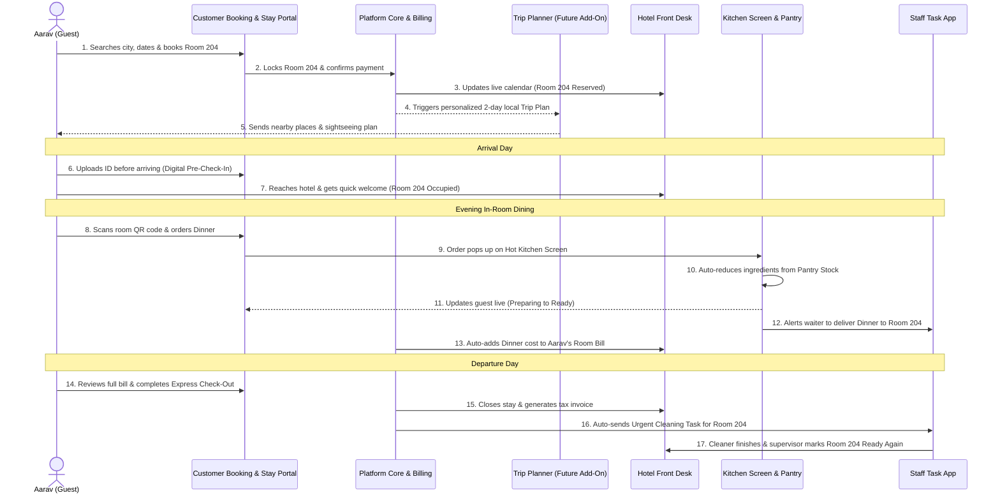

# 04 — End-to-End Flow, Safety Rules & Phased Roadmap

This chapter puts the **entire system together** into one real-life story so you can see how every module talks to the others, followed by our step-by-step build plan and key decisions to explore next.

---

## 1. One Complete Real-Life Journey (Customer + Hotel Together)

Imagine **Aarav** books a 2-night hotel stay. Watch how every piece of our system works together automatically:

---

## 2. What Makes This "Industry-Level" (Even Behind the Scenes)

To sell this to real hotels as a serious startup, four behind-the-scenes promises must always hold true:

1. **Zero Double-Booking Guarantee:**
   - If two customers click "Book Last Room" at the exact same second, the system locks the room for the first customer and politely tells the second customer before charging any money.
2. **Strict Privacy Between Hotels:**
   - Hotel A and Hotel B run on the same software platform, but their guest details, prices, kitchen recipes, and revenue reports are completely walled off from each other.
3. **Works Smoothly Even on Weak Hotel Wi-Fi:**
   - Reception and Kitchen screens should keep recent orders/check-ins safely queued and sync cleanly without losing tickets if hotel internet flickers.
4. **Honest Financial Trail (No Silent Deletions):**
   - Every room price edit, discount, cancelled kitchen item, and refund keeps a permanent record of *who changed it, when, and why*.

---

## 3. Phased Startup Roadmap (How We Move Forward Later)

Remember: right now we are **only exploring and shaping the idea**. When you eventually tell me it is time to build, here is the healthiest sequence so we never get overwhelmed:

### Phase 1: The Core Foundation (First Working Version)
- **Hotel Setup:** Owner/staff accounts, room types, room numbers, pricing, taxes.
- **Front Desk:** View live calendar, check guests in/out, handle basic room bills & invoices.
- **Customer Side:** Search hotel, pick rooms, pay securely, and get instant booking confirmation.
- *Outcome:* A hotel can already accept direct bookings and manage rooms professionally.

### Phase 2: Full Daily Hotel Operations (Kitchen + Staff + Room Experience)
- **Kitchen Suite:** Restaurant & Room-service ordering, live Kitchen Display Screen, recipes, pantry stock deduction, and wastage tracking.
- **Staff Suite:** Role permissions, shift schedules, attendance, and mobile task queue for housekeeping & repairs.
- **Customer In-Stay:** Room QR portal for ordering food, tracking cooking progress, requesting cleaning, viewing live bill, and express checkout.
- *Outcome:* The entire hotel runs as one connected machine.

### Phase 3: Startup Growth & Differentiator (Trip Ecosystem + Scale)
- **Trip Planner & Nearby Places:** Automated itineraries and curated local visiting spots unlocked on booking.
- **Local Partner Marketplace:** Bookable cabs, tours, and activities integrated into the trip plan.
- **Industry Scale Tools:** Multi-branch chain dashboard, WhatsApp bot, Booking.com/Airbnb sync, and smart dynamic room pricing.
- *Outcome:* A true standout startup product with multiple income streams.

---

## 4. Idea Exploration Checklist (Let's Clarify Together Next)

Since we are currently **exploring the vision before any coding**, here are the key big-picture questions we can think through and refine next:

1. **How Should Customers Find Hotels?**
   - **Model A (Software + Branded Website per Hotel):** Each hotel uses our software and gets its own booking website (like Shopify for hotels).
   - **Model B (One Central Marketplace + Hotel Software):** Travelers visit one main brand website/app (like Airbnb/Booking.com) to search all partner hotels, while hotels manage everything behind the scenes.
   - **Model C (Hybrid):** Hotels get their own booking page + optional listing on our central travel marketplace.
2. **Who Is Our Very First Ideal Customer?**
   - Independent boutique hotels & resorts (20–80 rooms)? Homestays & villas? Or city business hotels?
3. **Which Region & Currency First?**
   - India first (UPI, GST invoices, local hotel workflows) or Global first?
4. **What Extra "Many More" Features Are On Your Mind?**
   - Feel free to share any other ideas (spa, swimming pool passes, banquet halls, loyalty memberships, travel agency partnerships, etc.) so we can fit them cleanly into this blueprint!
