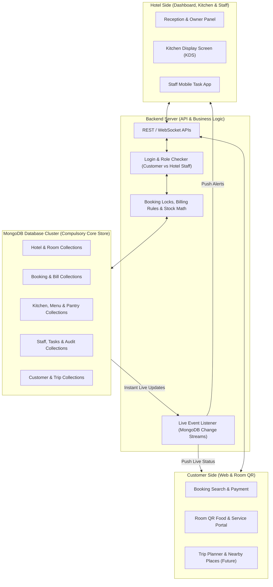
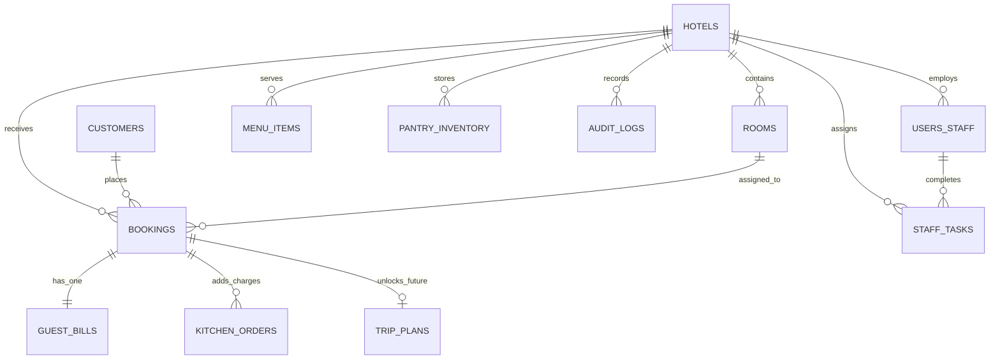
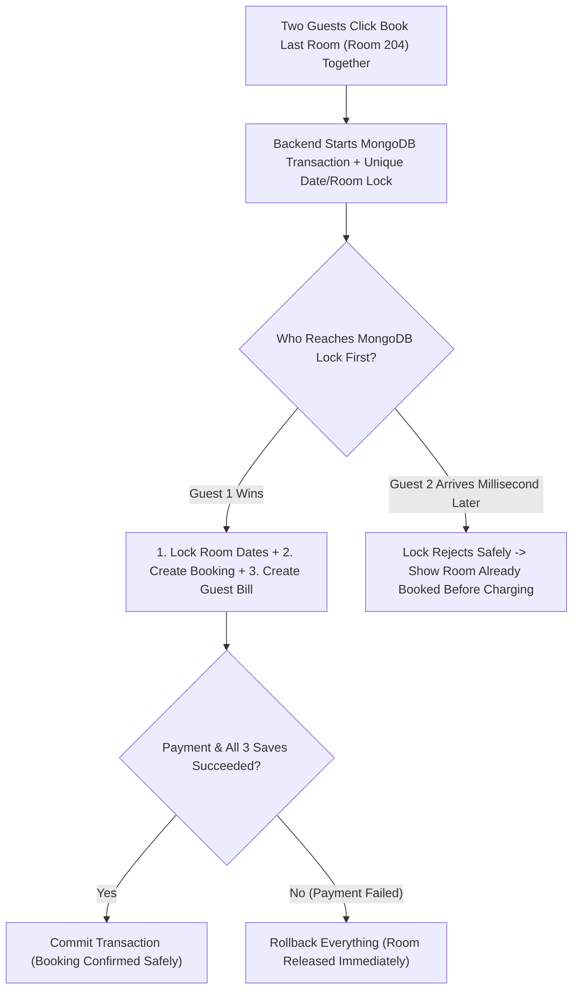
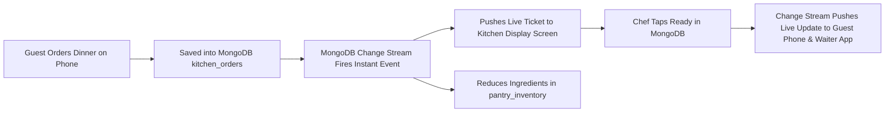
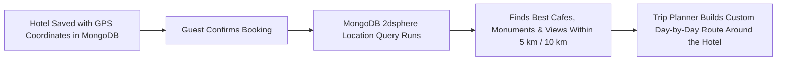
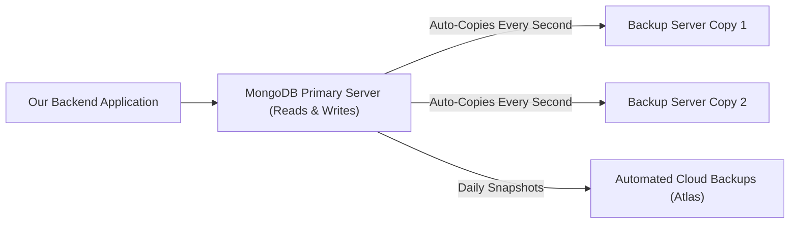

# 05 — Backend & MongoDB Architecture Explained (In Simple Words)

For our backend and database, **MongoDB is compulsory**. This document explains **why MongoDB fits our startup**, **how all data is organized**, and **how MongoDB guarantees safety, speed, and real-time updates**—all in plain English with clear diagrams.

---

## 1. Why MongoDB Works Great for This Startup

Think of a traditional spreadsheet database (like Excel) versus **MongoDB**:
- Traditional databases force every item into rigid rows and columns. If a hotel adds a new room facility, a custom spicy-level food option, or a brand-new Trip Planner field, you often have to redesign tables carefully.
- **MongoDB** works like smart digital folders (**Collections**) storing flexible JSON-style forms (**Documents**).

### What That Gives Us
1. **Flexible Hotel & Food Details:** A Suite room, a Restaurant Dish with extra toppings/allergens, and a 3-Day Trip Plan all have different details—MongoDB stores each naturally in one clean document.
2. **Easy Plug-In Future Features:** When we add the **Trip Planner**, **Banquet Hall**, or **WhatsApp Bot** later, we can add new fields and collections without breaking existing hotel or booking data.
3. **Built-In Real-Time & Location Power:** MongoDB natively includes **Change Streams** (for live Kitchen & Staff alerts) and **GPS Location Search** (for finding nearby visiting places around a hotel).

---

## 2. How Backend & MongoDB Sit Between Both Sides

---

## 3. Map of All MongoDB Collections (How Data Connects)

In MongoDB, instead of SQL tables, we organize data into **Collections**. Below is the complete map of how every collection connects:

### Simple Guide to Each Collection

| Collection Name | What It Stores (In Simple Words) | Example Inside One Document |
| :--- | :--- | :--- |
| **`hotels`** | Each partner hotel's name, city, **GPS location**, floors, tax rules, and plan | `{ hotelId, name, location: [lng, lat], taxRate, settings }` |
| **`users_staff`** | Hotel owners, managers, receptionists, chefs, cleaners, login & shift info | `{ hotelId, name, role: "chef", permissions, shiftSchedule }` |
| **`rooms`** | Every physical room, type (Deluxe/Suite), price rules, and **live status** | `{ hotelId, roomNumber: "204", type, price, status: "Occupied" }` |
| **`customers`** | Traveler profile, contact info, encrypted ID proof, allergies & VIP tag | `{ customerId, name, phone, preferences, stayCount }` |
| **`bookings`** | Who booked which room, check-in/out dates, add-ons, and stay status | `{ hotelId, customerId, roomId, checkIn, checkOut, status }` |
| **`guest_bills`** | One unified bill (Folio) holding room rent + food orders + taxes + payments | `{ bookingId, hotelId, lineItems: [...], payments: [...], balance }` |
| **`menu_items`** | Food & drink catalog, prices, **embedded ingredient recipe**, stock status | `{ hotelId, name, price, station: "Hot", recipe: [{ item, qty }] }` |
| **`pantry_inventory`** | Live kitchen ingredient stock levels, expiry dates, and supplier reorder rules | `{ hotelId, ingredient: "Paneer", stockQty, minAlertLevel }` |
| **`kitchen_orders`** | Live restaurant & room-service tickets sent to Kitchen Screen | `{ hotelId, bookingId, roomNo, items, status: "Preparing" }` |
| **`staff_tasks`** | Live cleaning, towel, delivery & repair tickets assigned to ground staff | `{ hotelId, type: "Cleaning", roomNo, assignedTo, status }` |
| **`audit_logs`** | Permanent security record of discounts, cancelled bills & refunds | `{ hotelId, staffId, action: "BillVoided", reason, timestamp }` |
| **`trip_plans`** *(Future)* | Custom day-by-day sightseeing plan + saved nearby spots per booking | `{ bookingId, tripStyle, days: [...], nearbyPlaces: [...] }` |

---

## 4. Smart MongoDB Data Rule: Keep Together vs. Link Separately

To keep MongoDB fast and clean as the startup grows, we follow one simple design rule:

1. **Keep Inside the Same Document (Embedding) — When items belong tightly together and stay small:**
   - Inside `menu_items`: store the dish's recipe ingredients right inside the dish document so the kitchen reads everything in **one fast lookup**.
   - Inside `kitchen_orders`: store the ordered dishes and guest notes (*"less spicy"*) directly inside the order ticket.
   - Inside `guest_bills`: store each bill charge line directly inside the stay's bill document (since one guest stay typically has 5–50 charges, not millions).
2. **Keep in Separate Collections (Referencing by ID) — When lists grow huge or are shared across screens:**
   - Keep `bookings`, `rooms`, `pantry_inventory`, `staff_tasks`, and `audit_logs` in their own collections linked by `hotelId` and `bookingId` so nothing gets bloated over years of hotel history.

---

## 5. Four Industry-Grade Superpowers Powered by MongoDB

### Power 1: No Double-Bookings & Safe Payments (ACID Transactions)
Even though MongoDB uses flexible documents, it supports **Multi-Document ACID Transactions**—meaning a group of steps either **all succeed together or all cancel cleanly**.

### Power 2: Instant Real-Time Screens (MongoDB Change Streams)
Instead of the Kitchen Screen or Reception refreshing the page every 5 seconds, **MongoDB Change Streams** automatically notify the backend the exact millisecond a document changes!

### Power 3: Strict Privacy Between Hotels (`hotelId` Separation)
Every hotel using our startup gets a unique `hotelId`.
- Every query from a hotel staff member automatically filters by **their `hotelId`**.
- MongoDB indexes start with `hotelId` (for example: `{ hotelId: 1, checkIn: 1 }`), making searches lightning fast while guaranteeing **Hotel A can never see Hotel B's rooms, money, or guests**.

### Power 4: Finding Nearby Visiting Places (MongoDB Geospatial `2dsphere` Search)
When we add the **Trip Planner & Nearby Places** module later, MongoDB natively understands map coordinates (Latitude & Longitude):

---

## 6. Reliability & Growth as Our Startup Scales

- **Never Goes Down Easily (Replica Sets):** MongoDB keeps live backup copies (`Secondary` servers). If the main server ever has a hardware issue, a backup server automatically becomes the main server in seconds—Front Desk and Kitchen keep working!
- **Cloud-Ready (MongoDB Atlas):** Automated backups, monitoring, and encryption out of the box.
- **Scales Across Cities & Countries:** When thousands of hotels join, MongoDB supports **Sharding** (splitting data neatly across servers by region/hotel) without rewriting our app logic.
